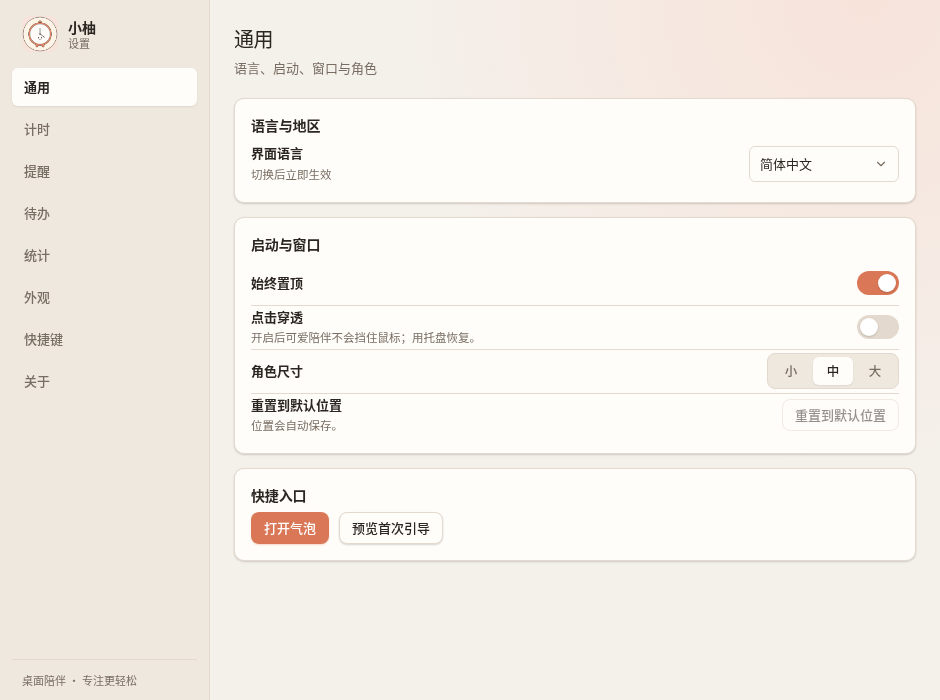
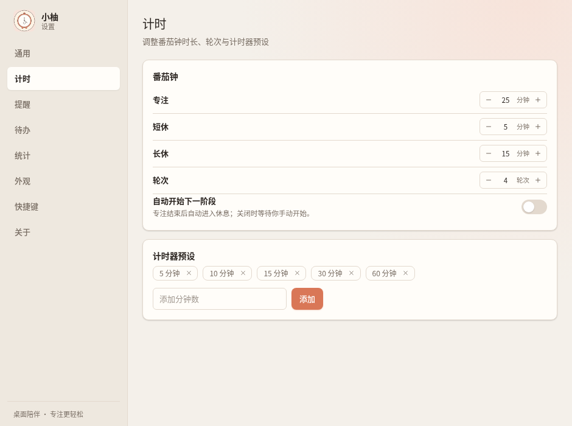
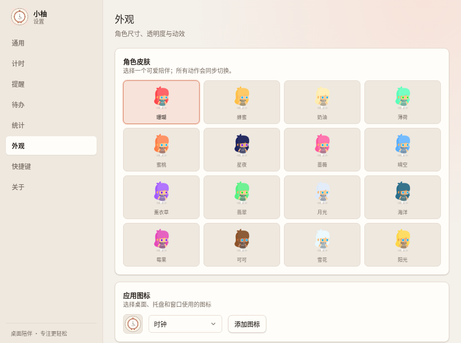
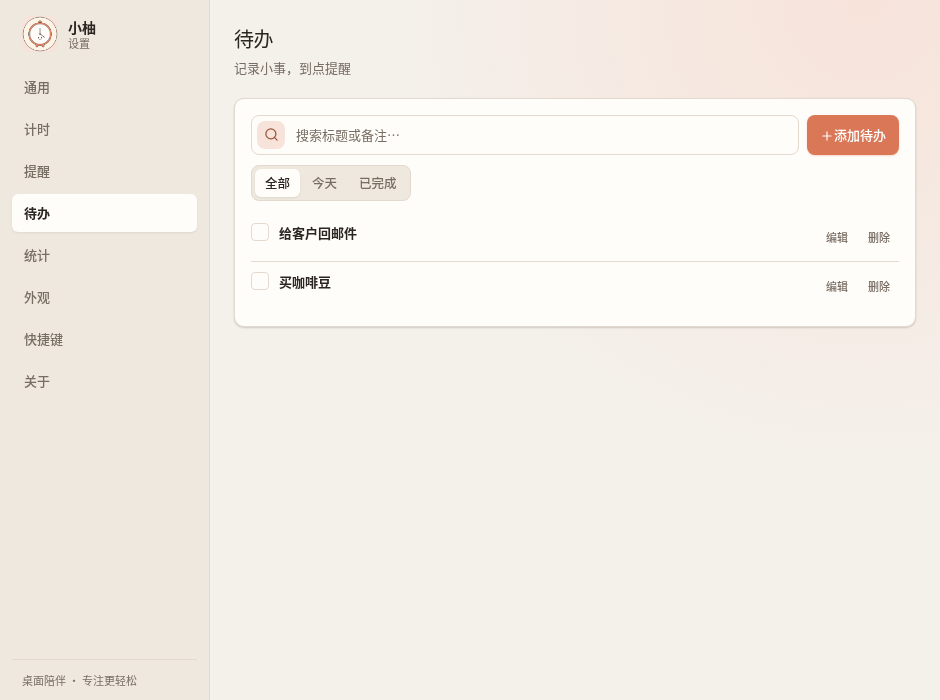
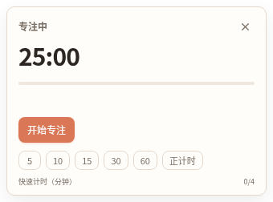
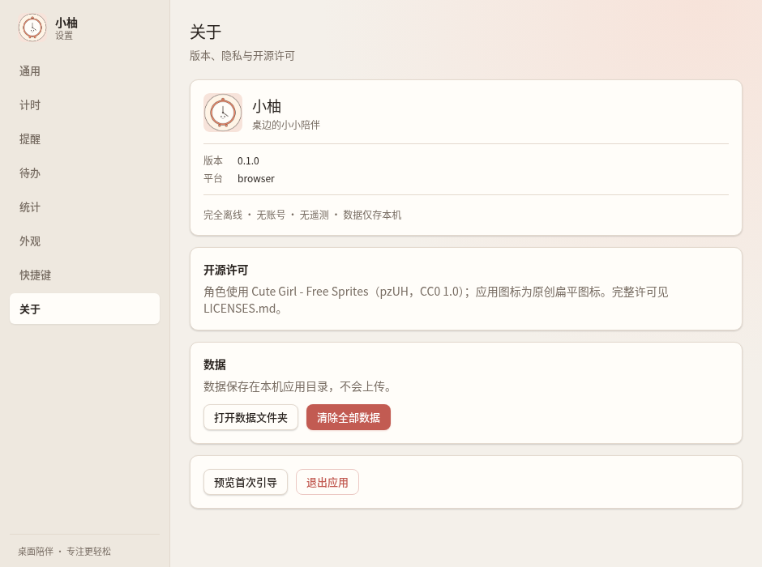
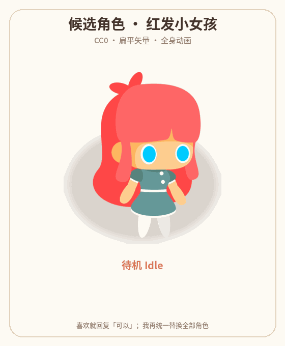

# 小柚 Yuzu

> 一只安静待在桌边的可爱陪伴，也是一枚轻量的专注助手。

**小柚（Yuzu）** 是一个完全离线的跨平台桌面应用。她会待在屏幕边缘，发呆、散步、打盹，也会在你点击时探头回应。需要进入工作状态时，她可以变成番茄钟、计时器、提醒器和待办清单，陪你把注意力放回眼前的事情上。



---

## 她是什么

- **桌面陪伴**：透明置顶的陪伴窗口，支持拖拽、吸附、边缘走动、点击反应和多种状态动画。
- **专注助手**：番茄钟、倒计时、正计时、阶段切换、自动开始、专注记录和统计。
- **温柔提醒**：喝水、久坐、护眼提醒，支持活跃时段、专注期间策略与稍后提醒。
- **待办清单**：弹窗式新增/编辑，截止时间、提醒时间和完成状态一目了然。
- **个性化**：16 套角色皮肤、10 套应用图标主题，也可以导入自己的图标。
- **完全离线**：无账号、无联网、无遥测；设置和记录保存在本机 SQLite 中。

## 界面一览

| 计时器 | 角色外观 |
| --- | --- |
|  |  |

| 待办清单 | 首次引导 |
| --- | --- |
|  |  |

| 专注气泡 | 关于与数据 |
| --- | --- |
|  |  |

角色素材使用 pzUH 的 **Cute Girl - Free Sprites**（CC0 1.0）。默认皮肤是珊瑚，共有 16 套配色；每套都包含待机、走路、坐下、睡觉、专注、休息、庆祝、拖拽、回应、提醒和低落等状态。



## 一些设计选择

### 为什么是“小柚”

“柚”是清爽、明亮又有点酸甜的柑橘。她不是需要被管理的工具，而是桌边一个会陪你一段时间的小家伙。英文名 **Yuzu** 简短、好念，也保留了同样的颜色和温度。

### 为什么用透明小窗口

小柚住在屏幕边缘，而不是在应用窗口里等待被打开。她应该像桌面上的一盏小灯：存在感刚刚好，需要时伸手就能碰到，不需要时可以安静待着。

### 为什么坚持离线

专注本身已经够复杂了。小柚不要求登录、不上传数据，也不靠网络维持基本功能。番茄钟、提醒、待办和统计都只属于这台电脑。

## 快速开始

### 环境要求

- Node.js 20+
- Rust stable 1.77+
- Tauri 2 的系统依赖

Ubuntu 22.04 / Debian 系：

```bash
sudo apt install libwebkit2gtk-4.1-dev libayatana-appindicator3-dev librsvg2-dev
```

macOS 需要 Xcode Command Line Tools；Windows 需要 WebView2 与 Visual Studio Build Tools。

### 打开方式

#### 原生应用

```bash
./desktop/yuzu
```

Linux 使用静态 ELF 启动器；macOS 使用 `desktop/open-app-macos.command`，Windows 使用
`desktop/open-app-windows.cmd`。启动器会按以下顺序寻找程序：

1. `desktop/resources/bin/yuzu`
2. `backend/target/release/yuzu`
3. `backend/target/debug/yuzu`
4. `YUZU_NATIVE_BINARY`

首次使用需要先构建 Tauri 程序：

```bash
npm run tauri -- build
```

如果本机使用本地 sysroot 运行库（例如 `/tmp` 下的 WebKitGTK），可以准备一份稳定入口：

```bash
./desktop/launcher/prepare.sh \
  --binary /tmp/xz-native-target/release/yuzu \
  --libdir /tmp/xz-merged-lib
```

> Linux ELF 是启动器，不会把 Tauri/WebKitGTK 打包进单文件。跨机器分发仍应使用
> Tauri 的 AppImage / deb / dmg / NSIS 安装包。

#### 桌面快捷方式

```bash
./install-desktop.sh              # 安装
./install-desktop.sh --uninstall  # 卸载（保留应用与数据）
```

脚本会自动识别 Linux、macOS 和 Windows Git Bash，生成对应的应用菜单和桌面入口。
旧的 `scripts/install-desktop-shortcut.sh` 仍可用，会转发到新入口。

#### 浏览器预览

```bash
./start.sh          # 启动 Vite
./start.sh --prod   # 构建后启动生产预览
./start.sh --build  # 仅构建前端
./start.sh --app    # 直接打开原生应用
./start.sh --open   # 启动后自动打开浏览器
```

浏览器模式使用 mock IPC，不会读写原生应用数据。启动后可访问：

- `http://127.0.0.1:1420/settings.html`
- `http://127.0.0.1:1420/pet.html`
- `http://127.0.0.1:1420/bubble.html`
- `http://127.0.0.1:1420/onboarding.html`

#### Tauri 开发

```bash
npm run tauri -- dev
```

### 检查与测试

```bash
npm run lint
npm run build
npm test

cargo fmt --manifest-path backend/Cargo.toml --check
cargo clippy --manifest-path backend/Cargo.toml --all-targets -- -D warnings
cargo test --manifest-path backend/Cargo.toml --lib
```

## 技术栈

| 层 | 选择 |
| --- | --- |
| 桌面壳 | Tauri 2 |
| 后端 | Rust + SQLite |
| 前端 | React 18 + TypeScript（strict） |
| 构建 | Vite |
| 样式 | Tailwind CSS + 设计 Token |
| 图标 | Lucide React + 项目原创图标资源 |
| 测试 | Vitest + Rust 单元测试 |

前端页面、组件、hooks、API 和类型都按职责拆分；后端按 `commands`、`windows`、`storage`、`timer`、`reminders`、`pet` 等领域组织。所有前后端源文件均不超过 200 行。

## 项目结构

```text
desktop-pet/
├── frontend/
│   ├── public/
│   │   ├── assets/character/    # 16 套角色皮肤与动作序列帧
│   │   └── brand/               # 应用图标主题
│   ├── shared/locales/          # 中英文文案
│   └── src/
│       ├── components/
│       │   ├── layout/          # 侧边栏、Header
│       │   ├── settings/        # 设置卡片、设置行、提示条
│       │   └── ui/              # Modal、Button、Select、日期时间等
│       ├── hooks/               # 业务逻辑
│       ├── lib/                 # IPC API、日期工具、i18n
│       ├── styles/              # Token 与样式拆分
│       ├── types/               # 共享类型
│       └── windows/             # pet/bubble/settings/onboarding
├── backend/
│   ├── src/
│   │   ├── commands/            # Tauri commands
│   │   ├── windows/             # 窗口、位置与品牌同步
│   │   ├── storage/             # SQLite 持久化
│   │   ├── timer/               # 计时引擎
│   │   ├── reminders/           # 健康提醒
│   │   └── pet/                 # 姿态与好感度
│   ├── icons/                   # 应用/托盘图标
│   └── tauri.conf.json
├── desktop/                     # Linux ELF 启动器、多平台入口与资源
│   ├── yuzu                     # Linux x86_64 静态 ELF
│   ├── launcher/                # Go 源码、构建与本地运行时准备
│   ├── open-app-macos.command
│   ├── open-app-windows.cmd
│   └── resources/               # 本机 Tauri 程序与运行库（不提交）
├── docs/                        # 设计、工程与发布文档
├── scripts/                     # 角色/图标生成、Tauri 开发启动
├── packaging/                   # 正式安装包桌面入口
├── install-desktop.sh           # 跨平台桌面快捷方式
├── start.sh                     # 浏览器预览启动器
└── README.md
```

## 文档

| 文档 | 内容 |
| --- | --- |
| [01 · 头脑风暴](docs/01-brainstorming-纪要.md) | 需求、范围与方案取舍 |
| [02 · PRD](docs/02-PRD.md) | 功能需求、用户故事与流程 |
| [03 · 交互设计](docs/03-交互设计.md) | 窗口结构、组件与交互 |
| [04 · 技术方案](docs/04-技术方案与工程规范.md) | 架构、IPC、数据与平台细节 |
| [05 · 构建与验收](docs/05-发布与验收.md) | 本地构建、产物清单与冒烟测试 |
| [06 · 代码拆分](docs/06-代码拆分与目录结构.md) | 目录结构、公共组件与 hooks |
| [07 · UI 一致性](docs/07-UI一致性与性能优化.md) | 样式复用与性能 |
| [08 · 组件规范](docs/08-前端设计与组件规范.md) | 视觉方向与组件约定 |
| [09 · 桌面快捷方式](docs/09-桌面快捷方式.md) | ELF 启动器、多平台快捷方式与启动 |
| [10 · 一致性复审](docs/10-代码与UI一致性复审.md) | 代码与界面检查 |
| [11 · 页面合规](docs/11-页面与组件合规检查.md) | 布局、API 与类型规范 |
| [12 · 性能审计](docs/12-性能审计与优化.md) | 渲染、资源与定时器 |
| [13 · 角色与图标](docs/13-角色与图标资源.md) | 素材来源、皮肤、图标与许可 |

## 许可

项目代码使用 MIT。角色素材来自 **Cute Girl - Free Sprites © pzUH, CC0 1.0**；应用图标为项目原创扁平图标。详细许可见 [LICENSES.md](LICENSES.md)。

---

如果小柚适合待在桌边，欢迎从这里开始：`npm install && npm run dev`。
